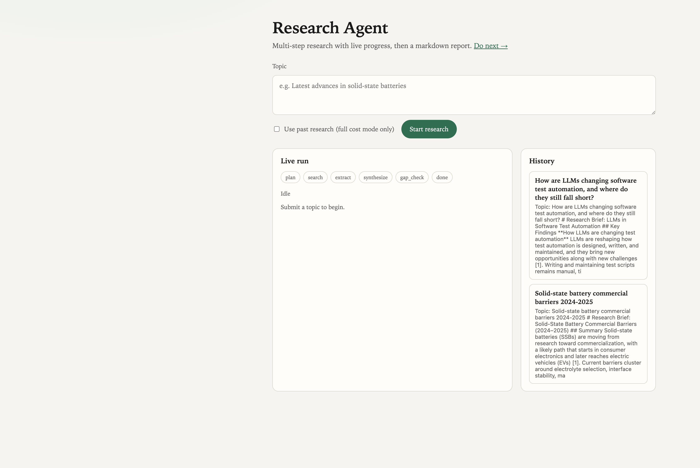
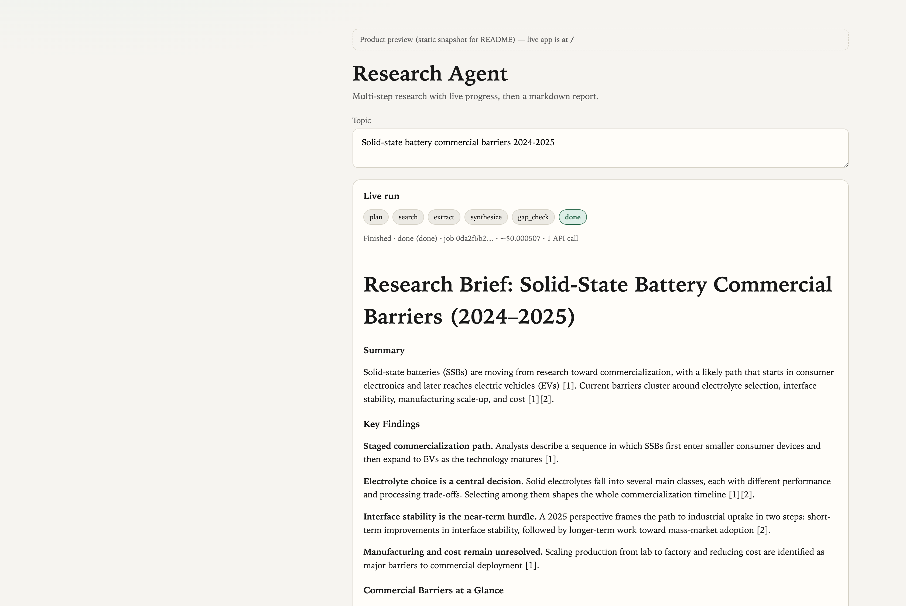

# Research Agent

Multi-step AI research agent: **FastAPI** + **LangGraph** + **Claude** + **ChromaDB**.

## Summary

Local research agent: topic in → web search → markdown report with sources → live SSE progress on `/` → finished work stored in **Chroma** (RAG/history). Orchestrated as a LangGraph pipeline (plan → search → extract → synthesize → gap_check → done). Default **`COST_MODE=min`** ≈ one Haiku call per job; set **`COST_MODE=full`** for the full agentic loop. **Job status is durable in SQLite** (upsert every node; in-flight jobs marked `interrupted` on restart). Structured logs include `job_id`, per-node timing, per-node token usage, and estimated USD cost. A Haiku 5.5 prompt that could exceed 100K input tokens is flagged (the whole request bills at 5× above that). Dedicated **`/report/{id}`** is still a stub (report shows inline on home).

**Next steps:** (1) finish the shareable report page + UI polish, (2) record live eval baselines, (3) CI + Docker, (4) auth, rate limits, and a spending cap, then deploy. Full plan: [ROADMAP.md](ROADMAP.md).

## Product preview

Inspectors can see the UI and a real finished report without running the server.

### Demo UI (home)

Topic form, live pipeline steps (`plan` → … → `done`), and history of past runs:



### Finished run + final report

Same product surface after a completed job (`COST_MODE=min`, Haiku 5.5, ~**$0.0005**, 1 API call). Topic: *Solid-state battery commercial barriers 2024–2025*:



Full markdown (with sources + cost/timing metadata): **[docs/sample-report.md](docs/sample-report.md)**

Static preview page (when the app is running): http://localhost:8000/static/product-preview.html

<details>
<summary>Sample report excerpt</summary>

```markdown
# Research Brief: Solid-State Battery Commercial Barriers (2024–2025)

## Summary
Solid-state batteries (SSBs) are moving from research toward commercialization,
with a likely path that starts in consumer electronics and later reaches electric
vehicles (EVs) [1]. Current barriers cluster around electrolyte selection,
interface stability, manufacturing scale-up, and cost [1][2].

## Key Findings
- Staged commercialization path (devices → EVs) [1]
- Electrolyte choice shapes the timeline [1][2]
- Interface stability is the near-term hurdle [2]
- Manufacturing and cost remain unresolved [1]

## Sources
[1] https://atomfair.com/battery-research/solid-state-battery-commercialization-timelines/
[2] https://www.sciencedirect.com/science/article/pii/S0378775325021913
```

</details>

## Architecture

```
plan → search → extract → synthesize → gap_check ─┬─→ search (max 2 loops in full mode)
                                                   └─→ done → ChromaDB
```

Job status is stored in SQLite (`JOBS_DB_PATH`); Chroma holds completed reports for RAG/history.

## Setup

```bash
cd research-agent
python3.11 -m venv .venv
source .venv/bin/activate
pip install -r requirements.txt
cp .env.example .env
# Edit .env with your ANTHROPIC_API_KEY
```

Optional (dev tests):

```bash
pip install -r requirements-dev.txt
pytest
```

## Run

```bash
uvicorn app.main:app --reload --host 127.0.0.1 --port 8000
```

| URL | What |
|-----|------|
| http://localhost:8000/ | Demo UI (topic, live SSE steps, report, history) |
| http://localhost:8000/static/product-preview.html | Static snapshot of UI + sample final report |
| http://localhost:8000/do-next | Older in-app roadmap page (see [ROADMAP.md](ROADMAP.md) for the current plan) |
| http://localhost:8000/docs | OpenAPI / Swagger |

If the browser shows `ERR_CONNECTION_REFUSED`, nothing is listening on that port — start uvicorn first.

## API

| Method | Path | Description |
|--------|------|-------------|
| GET | `/health` | Health check |
| GET | `/` | Demo UI |
| GET | `/do-next` | Older in-app roadmap page (superseded by `ROADMAP.md`) |
| GET | `/report/{id}` | Report page (**stub only** — not finished) |
| POST | `/research` | Start a research job |
| GET | `/research/{id}` | Poll status (SQLite → Chroma fallback) |
| GET | `/research/{id}/stream` | SSE progress events |
| GET | `/history?q=...` | List or search past sessions |
| GET | `/history/{session_id}` | Full stored report for a session |

### Start research

```bash
curl -X POST http://localhost:8000/research \
  -H "Content-Type: application/json" \
  -d '{"topic": "Latest advances in solid-state batteries", "use_past_research": false}'
```

### Poll result

```bash
curl http://localhost:8000/research/<job-id>
```

### Stream progress (SSE)

```bash
curl -N http://localhost:8000/research/<job-id>/stream
```

### Query past research

```bash
curl "http://localhost:8000/history?q=batteries&limit=10"
curl http://localhost:8000/history/<session-id>
```

## Project layout

```
app/
  main.py           # FastAPI app, / and /do-next, lifespan (Chroma + SQLite init)
  schemas.py        # Pydantic models
  static/
    index.html              # Demo UI (report still inline here)
    product-preview.html    # Static UI + baked sample report (for demos/README)
    do-next.html            # In-browser roadmap
    report.html             # Dedicated report page stub (not finished)
docs/
  ui-home.png               # README screenshot: home UI
  ui-report.png             # README screenshot: finished report
  sample-report.md          # Full sample final report + metadata
  jobs/
    store.py        # Durable SQLite jobs (upsert + interrupt-on-boot)
  observability.py  # JSON logs, token/cost tracking
  agent/
    state.py        # TypedDict state
    graph.py        # LangGraph wiring
    nodes.py        # plan, search, extract, synthesize, gap_check, done
    tools.py        # web_search, fetch_page, store_to_rag
  rag/
    store.py        # ChromaDB persist + upsert + session lookup
    retriever.py    # Semantic retrieval + scoring
    memory.py       # Past-session context for new jobs
  routers/
    research.py     # Job endpoints + SSE
    history.py      # History endpoints
  eval/
    dataset.py      # 16 research questions + expected phrases
    score.py        # facts, citation match, coverage
    run.py          # python -m app.eval.run --live
tests/              # pytest suite
```

## Cost mode (default: minimum API spend)

By default the agent uses **`COST_MODE=min`**: about **one** Anthropic call per research job.

| Setting | `min` (default) | `full` |
|---------|-----------------|--------|
| Model | Haiku (`ANTHROPIC_MODEL`) | Same env, or set Sonnet yourself |
| Plan | No LLM — search the topic as-is | Claude plans 1–N sub-questions |
| Extract | Snippets only (no page LLM) | Fetch pages + Claude per source |
| Synthesize | 1 short Haiku brief (~1k tokens max) | Longer report |
| Gap loop | Off (0 extra searches) | Up to 2 re-search loops |

```bash
# .env — thrifty (default)
COST_MODE=min
ANTHROPIC_MODEL=claude-haiku-5-5

# richer / more expensive
COST_MODE=full
ANTHROPIC_MODEL=claude-sonnet-5-5
```

`GET /health` reports `cost_mode` and `anthropic_model`.

## Evals

Sixteen questions in `app/eval/dataset.py`. A report is scored on three things: factual phrases present, inline citations whose URLs are in the retrieved sources, and coverage of expected aspects. The check is lexical, so a true paraphrase can score low. Use it as a tripwire: if a change lowers the mean versus `eval_results/baseline.json`, revert it or leave it flagged.

```bash
python -m app.eval.run          # list the set; no API calls
python -m app.eval.run --live --save-baseline
python -m app.eval.run --live   # exits 1 when scores drop vs the baseline
```

Live runs spend `ANTHROPIC_API_KEY` credits. Results land in `eval_results/` (gitignored). Compare runs that use the same `COST_MODE` and model.

## Notes

- Web search defaults to DuckDuckGo HTML (no extra API key). Set `SEARCH_PROVIDER=tavily` or `serper` (with the matching API key) for a more reliable provider; if DuckDuckGo returns nothing or errors, Tavily/Serper are tried when keys are set.
- Claude calls retry up to 3 times with exponential backoff.
- Research reports persist in Chroma under `CHROMA_PERSIST_DIR` (default `./chroma_data`).
- **Job id equals Chroma `session_id`.**
- Job lookup: **SQLite** first, then Chroma for older completed sessions.
- On startup, non-terminal SQLite jobs are marked **`interrupted`** (pipeline does not auto-resume).
- Observability: stdout JSON logs (`job_created`, `llm_usage`, `node_finished`, `job_completed`) with `job_id`. Each Claude call logs `input_tokens` and `output_tokens` tagged by LangGraph node. `cost` on `GET /research/{id}` adds `nodes` (ranked by estimated USD), `dominant_node`, and `long_context_flags`. Haiku 5.5 input above 100K tokens is priced at 5× for that whole request (`llm_long_context`); a prompt whose estimate reaches the threshold is logged as `llm_long_context_risk` before the call.
- SQLite path: `JOBS_DB_PATH` (default `./data/jobs.db`, gitignored).

## Recent changes (local, not requiring deploy)

- **Demo UI + SSE** — live step progress at `/` via `GET /research/{id}/stream`.
- **Chroma recovery** — completed jobs reload after restart; `GET /history/{session_id}` for full reports.
- **Search fallback** — optional Tavily/Serper when DDG fails (see `.env.example`).
- **Tests** — `pytest` with mocked Claude/search (`requirements-dev.txt`).
- **`/do-next` page** — in-app roadmap (now superseded by `ROADMAP.md`).
- **Durable SQLite jobs** — upsert on every node; no in-memory `_jobs`; interrupt non-terminal jobs on boot.
- **Observability** — structured logs + `timing` / `cost` on job status responses.
- **Report page stub** — `GET /report/{id}` serves a placeholder; full page not built yet (plan below).

## Roadmap

The full plan lives in **[ROADMAP.md](ROADMAP.md)**: four phases (finish the demo, prove it works with eval numbers, make it safe to deploy, tell the story), plus stretch goals and a list of what has shipped.

Top three priorities: finish the `/report/{id}` page, record eval baselines, and deploy with auth and a spending cap.
